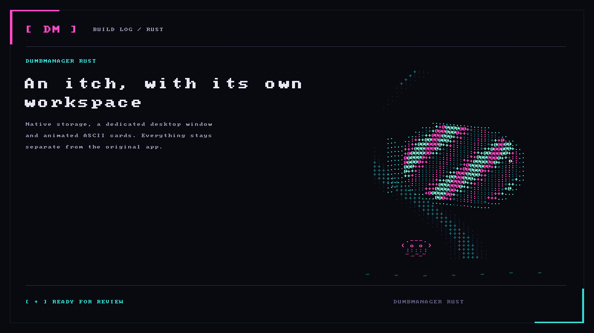

# DumbManager Rust

A separate Windows edition of DumbManager. The original HTML, CSS, fonts and
full-page ASCII animation run in WebView2; Rust handles storage and native services.

[](docs/media/native-card.png)

The port is in progress. It uses its own data folder and Windows identity, and
never imports accounts, keys or records from the Python edition automatically.
See the [current migration inventory](docs/migration-inventory.md) before using it
as a replacement.

## Run on Windows

Download the Windows installer from [Releases](https://github.com/ChickenStrxps/dumbmanager-rust/releases)
and run the setup executable. WebView2 is
required. Keep `LICENSE` and `THIRD_PARTY_NOTICES.txt` alongside a standalone EXE.
MCP clients use the separate `dumbmanager-mcp.exe` console program.
Settings → Connections includes signed application updates and an optional startup
check. Installation always requires confirmation. See [release/update setup](docs/updates.md).

## Available services

- Local SQLite capture, moments, edits, search, stashing and explicit review.
- The original interface, navigation and fine ASCII animation.
- App-owned image/video evidence, configurable video frameboards and OCR masks.
- Social drafts, original animated card rendering and explicit webhook delivery.
- Configurable T3 connections, project registration, chat and itch handoffs.
- Configurable Mercury suggestions, Jev judgments, research and inspiration.
- Isolated Browse sessions and Git operations on registered folders.
- Opt-in screen-region snips and bounded selected-window replay.
- Optional voice adapters, scoped stdio MCP and a paired phone connection.

External services start unconfigured and use your own credentials. Provider,
phone and external-client compatibility still need live checks. Desktop snipping
and selected-window replay are implemented and checked with synthetic windows;
live Discord delivery and Windows clipboard paste remain unverified. Mercury and
Jev connection tests, read-only T3 thread discovery and Discord bot/application
authentication have passed using this edition's saved configuration. These checks
do not establish end-to-end delivery, phone access or microphone/audio behavior.
No successful connection or operation is simulated.

## Build from source

Install Rust 1.90 or newer with the Windows MSVC toolchain, Microsoft C++ Build
Tools, WebView2, Node.js 24 and Python 3 for dependency license collection.
See the [Tauri Windows prerequisites](https://v2.tauri.app/start/prerequisites/#windows).

```powershell
npm ci
python tools/generate-notices.py
npm run build
```

The executable and installer are under `src-tauri/target/release/`. The packaged
app needs no Python runtime. `tools/generate-art.py` rebuilds its icon artwork.
Development test suites and smoke runners are intentionally kept outside this repo.
The build workflow still compiles the app and checks syntax, formatting and warnings.

MIT licensed. Fonts and dependencies retain their own notices.
